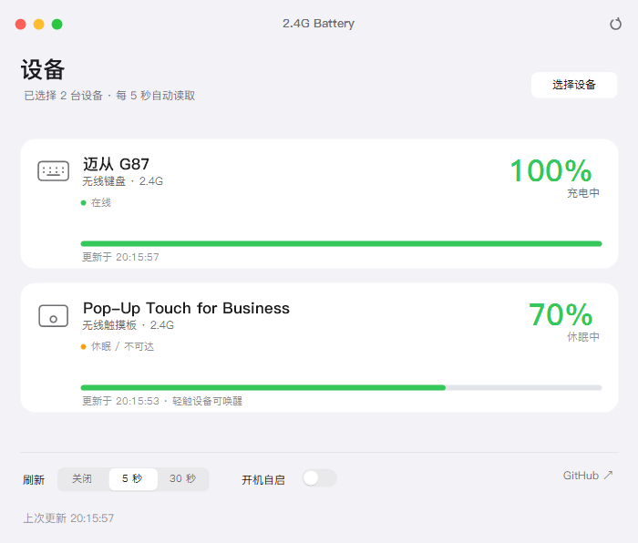

# 2.4G Battery

> ## ⚠️ 请用户自行使用 AI Agent 基于本仓库源码进行设备匹配
>
> 本仓库只保证作者手上的 **迈从 G87** 与 **罗技 Pop-Up Touch for Business** 能读到电量。
> 其它品牌 / 型号的 2.4G 设备（不同电量特性、不同报告 ID、不同状态字节）**请自行用 AI Agent
> 阅读本仓库源码后适配**：把设备 VID/PID、HID 报告描述符、原始报告字节喂给 AI Agent，
> 让它照着 `src/BatteryWidget.Core/Protocols/` 里的写法新增或修改一个 Provider 即可。

Windows 桌面小工具，自动扫描 2.4G 无线设备并显示电量，常驻系统托盘。



## 界面（macOS 风格）

- **无边框窗口 + 交通灯**：左上角红黄绿三颗按钮——红灯收进托盘、黄灯最小化、绿灯缩放；悬停显示 ×/−/+。
- **自定义标题栏**：居中标题 + 右侧工具栏图标按钮（刷新，SF Symbols 风格 `arrow.clockwise`）；可拖动移动窗口，双击标题栏缩放；四边/四角 6px 热区可拖拽改大小，Win11 下自动圆角。
- **大标题布局**：内容区顶部是「设备」大标题 + 灰色副标题，右侧次要按钮「选择设备」。
- **macOS 控件**：分段控件（Segmented Control：关闭 / 5 秒 / 30 秒）、带动画的开关（Switch）、蓝色主按钮 / 白底次按钮。
- **SF Symbols 风格线描图标**：键盘、触摸板、鼠标均为自绘 1.5px 线描，不使用 Windows 字体图标。
- **扁平白卡片**：纯白圆角块，无描边、无投影、无悬停交互。
- 字体优先 **PingFang SC / PingFang HK / 苹方-简** → MiSans → HarmonyOS Sans SC → `Segoe UI Variable Text` → `Segoe UI` → 微软雅黑（装了苹方就自动用，否则逐级回退）。

## 工作方式

1. **自动扫描**：枚举系统 HID 接口，按三类通道找可读电量的设备：
   - 迈从（MCHOSE）`41E4:*`：`0xFF04` 使用页上的 Feature Report `RID 0x06`；
   - 罗技接收器 `046D:C548`：HID++ 2.0，逐个接收器索引读出已配对设备的名称和电量；
   - 通用 HID：设备在 Feature Report 里声明了标准电量字段（`0x0006/0x0020` 电池强度、`0x0085` 电池系统等）。
2. **用户勾选**：点「选择设备」弹出扫描结果，勾选要显示的设备（下图），选择结果保存到本地，下次启动沿用。
3. **首次运行**：自动勾选所有扫描到、且能读到电量的设备，之后以你的勾选为准。


## 已验证的设备

| 设备 | 识别方式 | 电量来源 |
| --- | --- | --- |
| 迈从 G87 无线键盘 | USB `41E4:2001`（"MCHOSE 2.4G Wireless" / Compx） | `0xFF04` Feature Report `RID 0x06`，第 3 字节为 0–100 电量 |
| 罗技 Pop-Up Touch for Business | USB `046D:C548`（Logi Bolt 接收器，索引 4） | HID++ 2.0 特性 `0x1004`：**fn1** 返回真实百分比（`46 08` = 70%），fn0 的第 3 字节是充电状态 |

> 罗技这台机型有点特殊：`0x1004` 的 fn0 首个字节不是百分比（实测 `0x0F`=15），fn1 才是真实电量（`0x46`=70，与 Logi Options+ 一致）。程序优先用 fn1，读不到时回退 fn0。

## 功能

- 每台选中设备一张卡片：名称、类型、连接方式、在线状态、电量百分比、充电/放电状态、电量条。
- **立即刷新**：点标题栏右上的刷新图标，对休眠设备做多轮 HID++ 唤醒尝试后再读。
- **刷新间隔**：分段控件选择「关闭 / 5 秒 / 30 秒」，默认 5 秒轻量探测，不阻塞界面。
- **开机自启**：写入 `HKCU\Software\Microsoft\Windows\CurrentVersion\Run`。
- **低电量提醒**：低于 20% 时弹一次 Windows 系统通知（回到 25% 以上后重置）。
- **托盘图标**：macOS 菜单栏风格的电池（圆角轮廓 + 电极 + 按电量填充），随系统深浅色自动黑/白，充电时绿色 + 闪电，低于 20% 变红；悬停显示各设备百分比。
- 关闭窗口最小化到托盘；托盘双击恢复，右键菜单可刷新或退出。
- 设置保存在 `%LOCALAPPDATA%\BatteryWidget\settings.json`（勾选的设备、刷新间隔）。

## 安装包

用 Inno Setup 7 打包，安装包自带 .NET 运行时，装完可直接运行。

```powershell
powershell -File scripts\build-installer.ps1
```

产物：`dist\installer\2.4G-Battery-Setup-1.0.0.exe`（约 42 MB）

- 默认安装到 `%LOCALAPPDATA%\Programs\2.4G Battery`，**不需要管理员权限**；
- 可选任务：桌面快捷方式、开机自启；
- 卸载：开始菜单里的「卸载 2.4G Battery」或 Windows「设置 → 应用」；
- 用户配置（勾选的设备、刷新间隔）保存在 `%LOCALAPPDATA%\BatteryWidget\settings.json`，卸载时保留。

## 运行

```powershell
# 安装版
"%LOCALAPPDATA%\Programs\2.4G Battery\BatteryWidget.exe"

# 绿色版（框架依赖，需要本机 .NET 10 桌面运行时）
.\dist\BatteryWidget\BatteryWidget.exe

# 或从源码运行
dotnet run --project src\BatteryWidget
```

## 构建

需要 .NET 10 SDK（Windows）。

```powershell
dotnet build src\BatteryWidget\BatteryWidget.csproj -c Release

# 发布（依赖本机 .NET 10 桌面运行时，体积小）
powershell -File scripts\publish.ps1

# 发布（自包含单文件，免安装运行时，约 80MB）
powershell -File scripts\publish.ps1 -SelfContained
```

## 项目结构

```
src/BatteryWidget.Core/              协议与设备读取（无 UI 依赖）
  Hid/                               HID 枚举、重叠 I/O、报告描述符、HidP 值字段读取
  Devices/DeviceModels.cs            快照 / 读取请求 / 候选设备模型
  Protocols/MchoseProvider.cs        迈从 0xFF04 电量
  Protocols/LogitechProvider.cs      罗技接收器多设备电量（HID++ 1.0 / 2.0）
  Protocols/StandardBatteryProvider.cs 通用标准 HID 电量字段
  Protocols/HidppTransport.cs        HID++ 短/长报文传输层
  Services/DeviceDiscovery.cs        扫描可勾选设备
  Services/DeviceService.cs          按勾选读取，单个失败不影响其它设备
src/BatteryWidget/                   WinForms 界面 + 托盘
  MacForm.cs                        无边框窗口：交通灯、拖动、边缘缩放、圆角、标题栏工具栏
  MacTheme.cs                       配色、字体、圆角与投影
  MacButton.cs / MacSwitch.cs / MacSegmentedControl.cs / MacIconButton.cs
  SfIcon.cs                         SF Symbols 风格线描图标（自绘）
  DeviceCard.cs                     扁平电量卡片（自绘）
  DeviceRow.cs                      设备选择行（自绘）
  DeviceSelectionForm.cs            设备勾选窗口
  AppSettings.cs                    本地设置持久化
  app.ico                           应用图标（安装包/快捷方式共用）
tools/HidProbe/                      逆向 / 诊断命令行工具
installer/BatteryWidget.iss          Inno Setup 安装脚本
scripts/publish.ps1                  绿色版发布脚本
scripts/build-installer.ps1          打包安装程序（发布 + ISCC）
```

### 想支持新设备？

在 `Protocols/` 下加一个 `IDeviceProvider`，并在 `DeviceDiscovery.Scan()` 里加一段识别逻辑即可，界面不需要改。

## 诊断工具

```powershell
dotnet run --project tools\HidProbe -- read      # 用正式代码路径读一遍电量
dotnet run --project tools\HidProbe -- logi      # HID++ 协议 / 寄存器实验
dotnet run --project tools\HidProbe -- wake      # 唤醒并读取罗技设备
dotnet run --project tools\HidProbe -- dev 4     # 指定接收器索引的详细特性（含特性枚举）
dotnet run --project tools\HidProbe -- mchose-raw2  # 迈从配置通道原始探测
```

## 已知限制

- **罗技设备休眠**：2.4G 设备闲置几秒后会休眠，HID++ 请求返回 `CONNECTION_REQUEST_FAILED`。界面保留上次读数并标「休眠中 · 轻触设备可唤醒」，点「立即刷新」会做唤醒尝试。
- **Logi Options+ 冲突**：Options+ 可能占用接收器的 HID++ 接口。若提示打不开 HID++ 接口，退出 Options+ 后重试。
- **扫描时设备在休眠**：该设备不会出现在选择列表里。唤醒设备后点「重新扫描」。
- **迈从设置**：官方未公开键盘配置协议，目前只读电量。`0xFF02` 配置通道已确认（唯一可用 Report ID `0x13`、带校验字节），但灯效/回报率/休眠/按键映射的命令语义未确认，因此不写入任何配置。
- **有线连接**：目前只验证 2.4G 接收器；USB 线直连时 PID 会变化，暂未适配。

## 字体

界面字体**内嵌**在程序里，用的是苹方（PingFang SC）：

- `src/BatteryWidget/Fonts/PingFangSC-Regular.ttf`（常规）
- `src/BatteryWidget/Fonts/PingFangSC-Semibold.ttf`（粗体）

编译时作为 `EmbeddedResource` 打进程序集，启动时用 `PrivateFontCollection.AddMemoryFont` 从内存加载，
所以**不需要在系统里安装字体**，换台机器界面也是苹方。找不到内嵌字体时才按
`Segoe UI Variable Text` → `Segoe UI` → `微软雅黑` 回退。

> 注意：苹方是苹果的系统字体，字体文件来自第三方打包仓库（该仓库以 MIT 许可分发打包代码）。
> 如果要公开发布，请自行确认字体授权；不想把字体放进仓库的话，把 `src/BatteryWidget/Fonts/*.ttf`
> 加进 `.gitignore` 即可，但别人克隆后需要自行放置字体才能编译。

